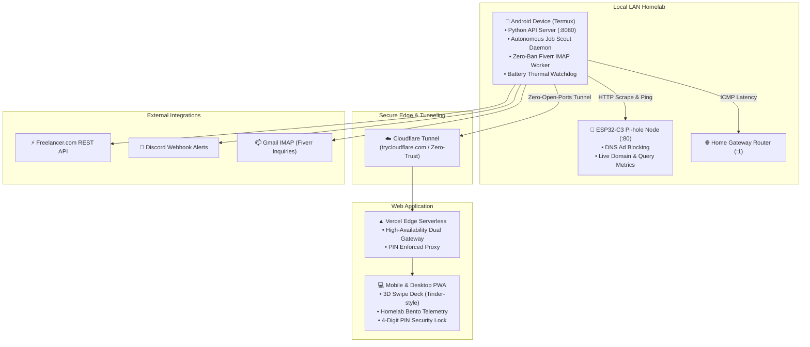

# ⚡ Homelab OS // Hardware Freelance Command Center

> Transform any old Android phone into a 24/7 autonomous Homelab node, high-speed Freelancer & Fiverr scout, and interactive Swipe-to-Bid PWA with local ESP32 Pi-hole integration.

[](LICENSE)
[](https://termux.dev)
[-blue.svg)](#installable-pwa)
[](#esp32-pi-hole-integration)

---

## 🏛️ System Architecture



---

## 🌟 Key Features

1. **Repurpose Old Android Phones as 24/7 Homelab Nodes**
   - Runs lightweight pure-Python HTTP API and cron daemons inside Termux with minimal RAM footprint (< 35 MB).
   - Zero root required! Includes an ADB debloater script (`optimize_phone.sh`) that sets animation scales to 0 and disables heavy OEM background services.
   - Screen stays completely off while `termux-wake-lock` keeps the CPU active.

2. **24/7 Autonomous Hardware Scout (KiCad, PCB, 3D Case Design)**
   - High-speed polling against the official Freelancer.com REST API.
   - Strict keyword matching for hardware niches: `kicad`, `pcb`, `schematic`, `gerber`, `breadboard`, `fritzing`, `enclosure`, `3d print`, `stl`, `step`, `esp32`, `arduino`, `2-layer`, `bom`.
   - Comprehensive blacklist rejection: drops projects containing `trading`, `crypto`, `forex`, `4-layer`, `rf design`, `mains voltage`, etc.
   - Never auto-bids without your explicit approval — stages matches into a pending queue.

3. **Zero-Ban Fiverr IMAP Listener**
   - Connects directly to `imap.gmail.com` using App Passwords.
   - Filters client inquiries from `@fiverr.com` and formats them into an actionable Live Inbox with one-click dismiss and reply links.

4. **Battery Thermal & ESP32 Watchdog Daemons**
   - **Battery Thermal Watchdog**: Reads `/sys/class/power_supply/battery/temp`. If battery temp exceeds **39.0°C**, fires an immediate `[THERMAL WARNING]` alert to your Discord Webhook.
   - **ESP32 Pi-hole Watchdog**: Checks HTTP port 80 of your ESP32 DNS ad-blocker every cycle. If unreachable for 2 consecutive checks, fires a Discord offline alert.

5. **Proxmox / Homelab Bento Dashboard & Swipe-to-Bid Deck**
   - **Homelab Aesthetic**: Deep obsidian matte background (`#0B0D10`), subtle emerald ambient glow, circular SVG radial gauges, and real-time SVG sparklines.
   - **Tinder-Style Swipe Deck**: Swipe Right (→) to configure and submit bids; Swipe Left (←) to dismiss.
   - **Strict 4-Digit PIN Lock**: Proxmox-style PIN lock overlay enforced on both frontend and backend (`X-Auth-Pin` header).

6. **Installable PWA (Android & iOS)**
   - Fully compliant Web App Manifest (`manifest.json`) and Service Worker (`sw.js`).
   - Thumb-friendly bottom navigation bar and 2x2 responsive sparkline grid on mobile screens.

---

## 🚀 Quick Start Guide

### Step 1: Set Up Your Android Phone (Termux)

1. Install **Termux** from [F-Droid](https://f-droid.org/packages/com.termux/).
2. Open Termux on your phone and run the one-command setup wizard:
   ```bash
   curl -sL https://raw.githubusercontent.com/Lojra/freelance-homelab-os/main/termux/setup_termux.sh | bash
   ```
3. The wizard will install Python, Cloudflared, configure your `.env`, and start the background scout cron.
4. Launch your Node API server and Cloudflare tunnel:
   ```bash
   bash ~/start_api_server.sh
   ```

### Step 2: (Optional) Optimize Phone via ADB

Connect your phone to your PC via USB and enable USB Debugging, then run:
```bash
bash termux/optimize_phone.sh
```
This disables background bloatware and turns off window animations so 100% of available RAM goes to Termux.

### Step 3: Deploy Frontend & Edge API to Vercel

1. Fork or clone this repository:
   ```bash
   git clone https://github.com/Lojra/freelance-homelab-os.git
   cd freelance-homelab-os
   ```
2. Deploy to Vercel:
   ```bash
   npm install -g vercel
   vercel --prod
   ```
3. Set your environment variables in Vercel Project Settings:
   - `DASHBOARD_PIN`: 4-digit PIN (default `1337`)
   - `J5_TUNNEL_URL`: Your `trycloudflare.com` tunnel URL
   - `FREELANCER_OAUTH_TOKEN`: Your Freelancer OAuth token
   - `FREELANCER_USER_ID`: Your Freelancer numeric user ID
   - `DISCORD_WEBHOOK_URL`: Your Discord Webhook URL
   - `ESP32_PIHOLE_IP`: Local IP of your ESP32 Pi-hole node (e.g. `192.168.1.50`)

---

## 🔒 Security & Privacy Architecture

- **Zero Cloud Storage**: All scouted job queues, Fiverr client inquiries, and logs remain strictly on your local Android device and client `sessionStorage`.
- **PIN Protected Endpoints**: All API routes (`GET /api/state`, `POST /api/bid`, `DELETE /api/fiverr`) strictly require an `X-Auth-Pin` header matching your configured `DASHBOARD_PIN`.
- **Zero Open Ports**: Uses outgoing Cloudflare Tunnels (or Tailscale) to communicate with Vercel without requiring port forwarding or exposing home IP addresses.

---

## 📄 License

Distributed under the [MIT License](LICENSE). Contributions, feature requests, and homelab setups welcome!
